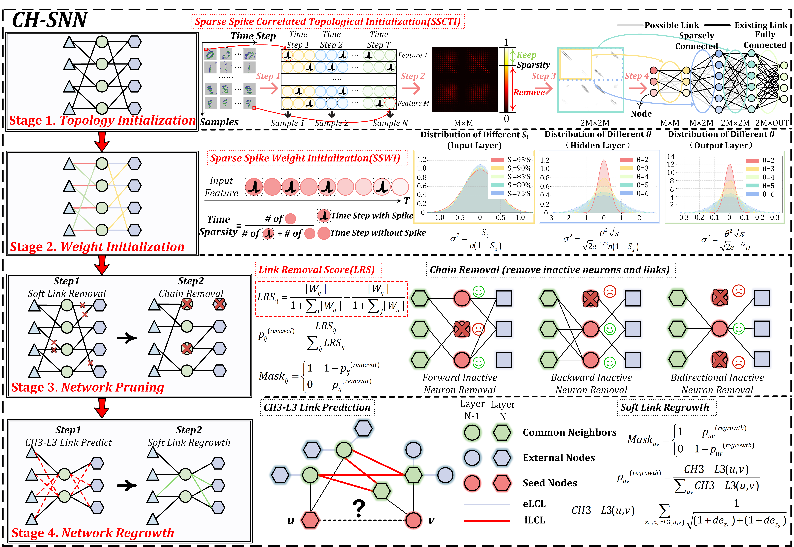
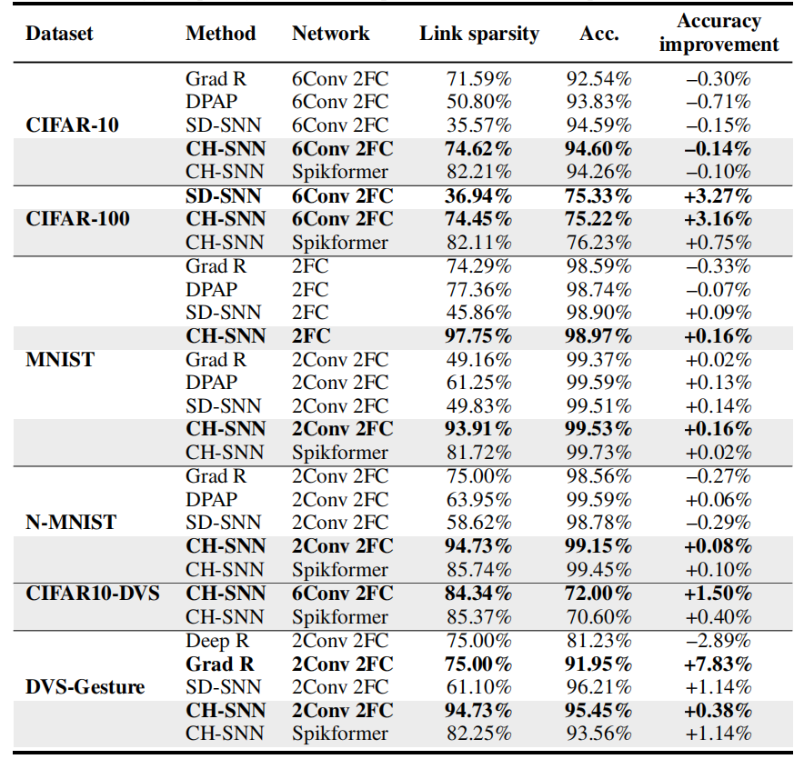
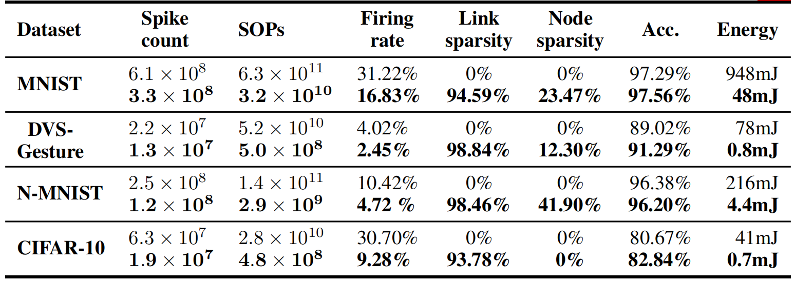

# Cannistraci-Hebb Training on Ultra-Sparse Spiking Neural Networks

## Contributions
* **Introducing a novel sparse training framework.** We propose a four-stage dynamic sparse training framework (CH-SNN) consisting of sparse topology initialization, sparse weight initialization, network pruning and network regrowth. CH-SNN attains 99\% structural connection sparsity in all linear layers and shows better performance than FC networks on the CIFAR-100, MNIST, N-MNIST, CIFAR10-DVS and DVS-Gesture datasets respectively.
* **Proposing efficient initialization methods.** We propose two initialization methods, one is Sparse Spike Correlated Topological Initialization (SSCTI) which initializes an ultra-sparse network structure by leveraging correlations among input nodes, another is Sparse Spike Weight Initialization (SSWI) which incorporates temporal activation sparsity and structural connection sparsity of SNNs to initialize weights. SSCTI and SSWI enhance the performance of the link predictor and facilitate faster training from the initial phases.
* **Demonstrating superior performance across architectures and datasets.** We have conducted extensive experiments, the experimental results demonstrate that CH-SNN outperforms existing sparse SNN training methods across six datasets (CIFAR-10, CIFAR-100, MNIST, N-MNIST, CIFAR10-DVS and DVS-Gesture) and three network structures. Notably, it attains a 0.16\% accuracy improvement over the FC network at a sparsity of 97.75\%. We apply CH-SNN to a hardware-friendly algorithm S-TP, which has been implemented on a neuromorphic processor for edge-side AI applications. Experimental results show that CH-SNN significantly improve energy efficiency, achieving an average improvement of 55$\times$ across four datasets.

## About Project
BrainCog is an open source spiking neural network based brain-inspired cognitive intelligence engine for Brain-inspired Artificial Intelligence, Brain-inspired Embodied AI, and brain simulation. More information on BrainCog can be found on its homepage http://www.brain-cog.network/. We use BrainCog in our project, the following paper is cited as the source for BrainCog.

```
@article{han2025adaptive,
  title={Adaptive sparse structure development with pruning and regeneration for spiking neural networks},
  author={Han, Bing and Zhao, Feifei and Pan, Wenxuan and Zeng, Yi},
  journal={Information Sciences},
  volume={689},
  pages={121481},
  year={2025},
  publisher={Elsevier}
}
  
@article{zeng2023braincog,
  title={Braincog: A spiking neural network based, brain-inspired cognitive intelligence engine for brain-inspired ai and brain simulation},
  author={Zeng, Yi and Zhao, Dongcheng and Zhao, Feifei and Shen, Guobin and Dong, Yiting and Lu, Enmeng and Zhang, Qian and Sun, Yinqian and Liang, Qian and Zhao, Yuxuan and others},
  journal={Patterns},
  volume={4},
  number={8},
  year={2023},
  publisher={Elsevier},
}
```
### Install
#### Install Online
1. You can install braincog by running:
```
pip install braincog
```
2. Also, install from github by running:
```
pip install git+https://github.com/braincog-X/Brain-Cog.git
```
#### Install locally
1. If you are a developer, it is recommanded to download or clone braincog from github.
```
git clone https://github.com/braincog-X/Brain-Cog.git
```
2. Enter the folder of braincog
```
cd Brain-Cog
```
3. Install braincog locally
```
pip install -e .
```
## Comprehensive Performance Comparison with Other Methods
Performance comparison of different methods on  CIFAR-10, CIFAR-100, MNIST, N-MNIST, CIFAR10-DVS and DVS-Gesture  datasets. The gray section indicates the performance of CH-SNN. For each dataset, we have bolded the method with the highest accuracy improvement and the one with the highest sparsity. We exclude Spikformer from our comparison here.

## Experiments on Hardware-friendly Algorithms S-TP
Performance and energy consumption of CH-SNN on MNIST, DVS-Gesture, N-MNIST and CIFAR-10 datasets (S-TP). For each dataset, the first row shows the performance of the fully connected network, and the second row shows that of the sparse network with CH-SNN.

## Training Example with Convolutional Neural Network
```
cd Conv_Net/Cifar10
python main.py
```

## Training Example with Spikformer
```
cd Spiking-Transformers
python main.py --dataset cifar10 --epochs 500 --batch-size 16 --seed 42 --model spikformer --in-channels 3 --chts True --num-classes 10
```